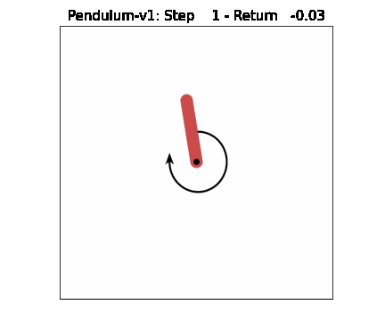

# Visualization

`Visualizer` turns a list of environment states into a Matplotlib animation.

{ width="360" }

## Recording an episode

Collect the states of one episode in a Python loop, then hand them to the visualizer:

```python
import jax
import jax.numpy as jnp
import gymnax
from gymnax.visualize import Visualizer

env, params = gymnax.make("Pong-misc")

key = jax.random.key(0)
key, key_reset = jax.random.split(key)
obs, state = env.reset(key_reset, params)

state_seq, reward_seq = [], []
for _ in range(200):
    state_seq.append(state)
    key, key_act, key_step = jax.random.split(key, 3)
    action = env.action_space(params).sample(key_act)
    obs, state, reward, terminated, truncated, info = env.step(
        key_step, state, action, params
    )
    reward_seq.append(reward)
    if terminated or truncated:
        break

returns = jnp.cumsum(jnp.array(reward_seq))
vis = Visualizer(env, params, state_seq, returns)
vis.animate("pong.gif")
```

GIFs are written with Pillow and need no further tools. The optional fourth argument
is shown in the title of each frame.

## Supported environments

| Environments | Rendered with |
| --- | --- |
| `CartPole-v1`, `Pendulum-v1`, `Acrobot-v1`, `MountainCar-v0`, `MountainCarContinuous-v0` | Gymnasium; install `gymnax[visualize]` |
| `Asterix-MinAtar`, `Breakout-MinAtar`, `Freeway-MinAtar`, `Seaquest-MinAtar`, `SpaceInvaders-MinAtar`, `Pong-misc` | Grid of the observation channels |
| `Catch-bsuite` | Grid |
| `PointRobot-misc` | Agent and goal region on a half circle |
| `MetaMaze-misc`, `FourRooms-misc` | Maze layout |

## Single frames

`Catch-bsuite`, `FourRooms-misc`, `MetaMaze-misc`, `PointRobot-misc` and `Pong-misc`
also define `env.render(state, params)`, which draws a single state and returns the
Matplotlib figure and axes.

Observations of the MinAtar environments and `Pong-misc` are multi-channel grids, not
rendered images. Each channel marks the cells occupied by one kind of object.
